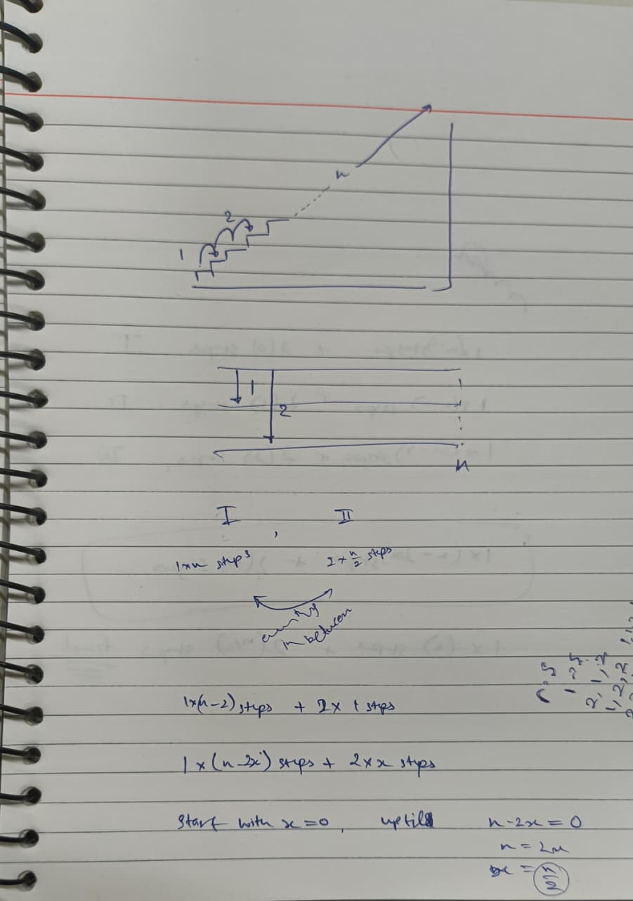

# Day 02: Recursion → bottom-up DP (Nov 02)

| # | Problem | Role | Approach | Time | Space | Edge case I missed |
|---|---------|------|----------|------|-------|--------------------|
| 1 | [Climbing Stairs](climbing_stairs.py) | Primary | for each count x of 2-steps, there are n - x moves in total, and we choose which x slots are the 2-steps. Add C(n - x, x) over all x from 0 to n // 2. C is computed with a hand-written factorial. | O(n^2) | O(n) | the loop stopped one short because range(n // 2) excludes its end value. That made n = 1 return 0 and every other answer too small. |
| 2 | [Fibonacci Series](var_1_fibonacci_series.py) | Variant 1 | Three versions: plain recursion with base cases F(0) = 0 and F(1) = 1, recursion with my own memo dict, and a loop with two variables that shift forward n times. | O(2^n) | O(n) | in fib_memo I first copied the sum demo (n + fib_memo(n-1)) and forgot the n == 1 base case, and in fib_loop I called fib_loop recursively inside a for, which made n = 20 hang. |
| 2 | [Tribonacci Series](var_2_tribonacci_series.py) | Variant 2 | Same three versions as Fibonacci, with a third term: T(n) = T(n-1) + T(n-2) + T(n-3), base cases 0, 1, 1. The loop keeps three variables and shifts them forward n times. | O(3^n) | O(n) | I copied the Fibonacci file and first left the recurrence at two terms, so everything from n = 3 on was wrong. |

