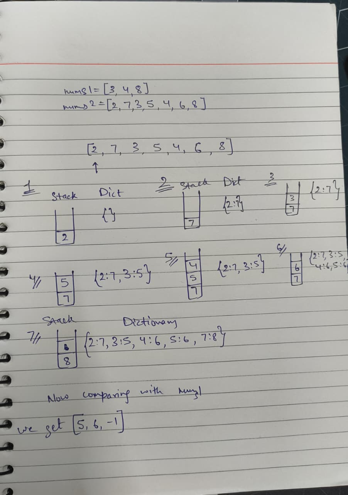

# Day 26: Monotonic Stack (Oct 26)

| # | Problem | Role | Approach | Time | Space | Edge case I missed |
|---|---------|------|----------|------|-------|--------------------|
| 1 | [Next Greater Element I](next_greater_element.py) | Primary | We take a stack to be able to compare the latest numbers with the next number and then compare if the next element is greater, then when we do find the greater number, we pop the stack and add the key and value to the dictionary which we will use later when checking with the other array and ultimately printing results | O(n) | O(n) | I checked for top of the stack with stack[-1] while stack was empty [] |
| 2 | [Daily Temperatures](var_1_daily_temperatures.py) | Variant  1 | We take just one input as we are supposed to deal with the days and the day numbers, then we deal with the stack to collect and then put to the dictionary once we have found the next day with the graeter temperature. I understood it by trying it out myself and then realising that it was rather a simpler program that the primary one as we did not need to compare two lists this time | O(n) | O(n) | Challenge faced was in understanding the given variant, but eventually got it |

