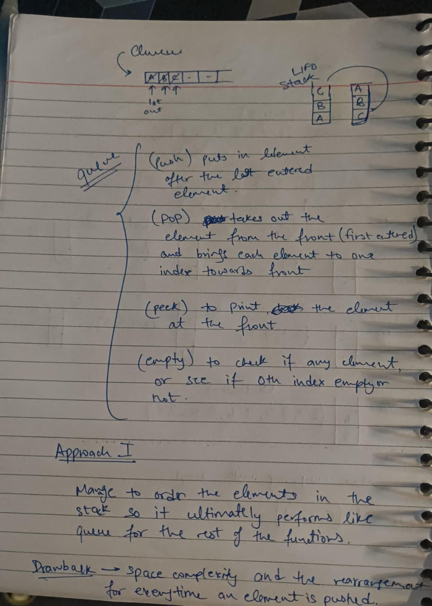
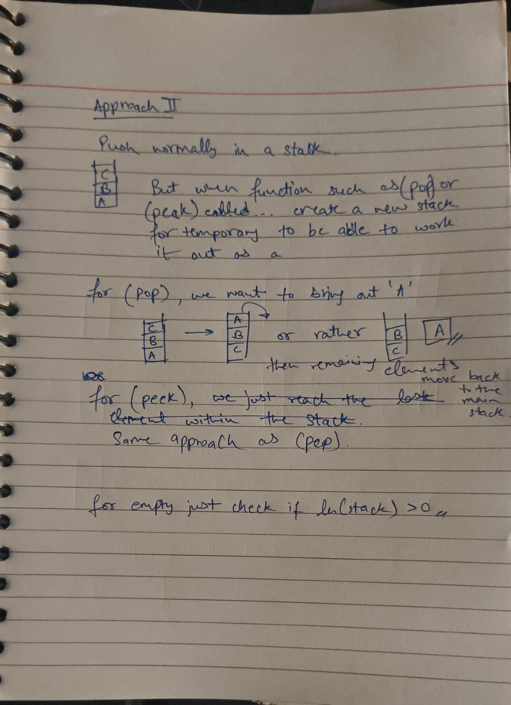

# Day 27: Two-stack FIFO simulation (Oct 27)

| # | Problem | Role | Approach | Time | Space | Edge case I missed |
|---|---------|------|----------|------|-------|--------------------|
| 1 | [Implementing Queue using Stacks](implementing_queue_using_stacks.py) | Primary | So I went from putting together how the functions of queue work and then try to imitate them using the operations we have available for stacks and also make use of another stack and rearrangement. For pop() and peek() we take another stack to reverse the order and pop or peek the top element of the tempStack and put back the remaining elements back into the mainStack. push() is just normal append in the mainStack and then empty() just checks for the len(mainStack) = 0 giving True else False | O(n) | O(n) | The pop() and peek() in my program had missed the part that after the popping and collecting form the mainStack to the tempStack, we also need to put the elements back into the mainStack |

