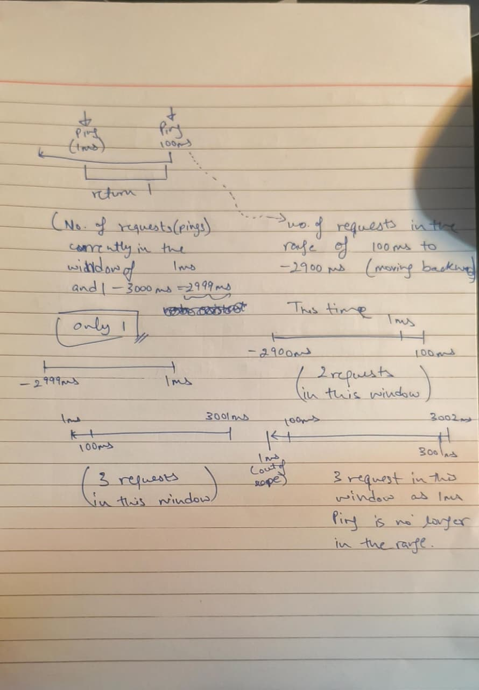
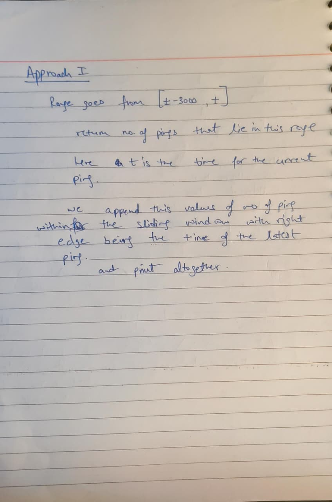

# Day 28: Monotonic queue (sliding window of time) (Oct 28)

| # | Problem | Role | Approach | Time | Space | Edge case I missed |
|---|---------|------|----------|------|-------|--------------------|
| 1 | [Number of Recent Calls](number_of_recent_calls.py) | Primary | We loop through the timestamps within the stack of the ping requests, if the request timestamp is >= t-3000 (the left edge of the sliding window, here t i sthe timestamp of the current ping request). In the loop we increment the counter value for the number of requests in the window at the time of that request and retrun the number | O(n) | O(n) | Understanding sliding windows was a bit of a challenge in the beginning, that took a lot of time, then optimizing loop, I initially went with while for as long as the condition matched we incremented the counter, but ultimately went with for loop for cleaner implementation |

